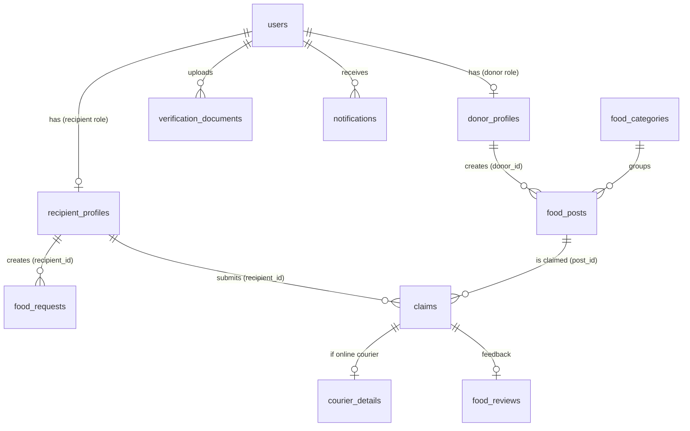

# FoodBridge — Database Reference

Source: final FoodBridge ERD (Visual Paradigm, 11 entities). Stack: Laravel + MySQL.
This document is the basis for generating migrations and models.

Note: table names, column names, and enum values are kept in Indonesian exactly as they appear in the ERD (English glosses are added where helpful).

Markers used in this document:
- **Null = Yes** → column marked `N` in the ERD.
- **⚠** → something needs to be checked, explained in the [ERD Findings](#7-erd-findings-to-check) section.
- **(proposed)** → not in the ERD/proposal, only a suggestion to make it ready for use in code.

---

## 1. Table Summary

| # | Table | Model | Purpose | Related PBI |
|---|---|---|---|---|
| 1 | `users` | `User` | Accounts & authentication for all roles (donor, recipient, administrator) | PBI-02 |
| 2 | `donor_profiles` | `DonorProfile` | Donor business profile + location point | PBI-04 |
| 3 | `recipient_profiles` | `RecipientProfile` | Recipient organization profile + location point | PBI-04 |
| 4 | `verification_documents` | `VerificationDocument` | Legal documents to be verified by the Admin | PBI-02, 03 |
| 5 | `food_categories` | `FoodCategory` | Food nutrition categories | PBI-05 |
| 6 | `food_posts` | `FoodPost` | Surplus food posts created by Donors | PBI-05, 06 |
| 7 | `food_requests` | `FoodRequest` | Request Board: urgent needs posted by Recipients | PBI-10 |
| 8 | `claims` | `Claim` | Recipient's claim on a post; the center of the handover flow | PBI-07, 09, 12 |
| 9 | `courier_details` | `CourierDetail` | Driver data (only if an online courier is used) | PBI-11 |
| 10 | `food_reviews` | `FoodReview` | Quality reviews **and** reports of unfit food (distinguished by `jenis_feedback`) | PBI-13, 14 |
| 11 | `notifications` | `InAppNotification` ⚠ | In-app notifications | PBI-08 |

There are no tables for the impact dashboard and Excel export. Their data is computed from joins across `claims`, `food_posts`, and the profile tables (PBI-15–17).

---

## 2. Relationship Diagram

Cardinality:

| Relationship | Cardinality |
|---|---|
| users ↔ donor_profiles | 1 : 0..1 (admins have no profile) |
| users ↔ recipient_profiles | 1 : 0..1 |
| users → verification_documents | 1 : 0..* |
| users → notifications | 1 : 0..* |
| donor_profiles → food_posts | 1 : 0..* |
| food_categories → food_posts | 1 : 0..* |
| recipient_profiles → food_requests | 1 : 0..* |
| recipient_profiles → claims | 1 : 0..* |
| food_posts → claims | 1 : 0..* |
| claims ↔ courier_details | 1 : 0..1 |
| claims ↔ food_reviews | 1 : 0..1 |

---

## 3. Table Details

ERD → Laravel type conversion: `integer(10)` → integer/`id()`, `varchar(n)` → `string(n)`, `decimal(10,7)` → `decimal(10,7)`, `timestamp` → `timestamp`, `date` → `date`, `binary(1)` → `boolean`.

### 3.1 `users`

| Column | Type | Null | Key | Description |
|---|---|---|---|---|
| id | integer(10) | No | PK | |
| nama | varchar(255) | No | U ⚠ | User name / PIC (person in charge) |
| email | varchar(255) | No | U | Login identity |
| password | varchar(255) | No | | Hash |
| no_hp | varchar(20) | No | | Phone number |
| role | varchar(255) | No | | `donor` / `penerima` / `administrator` |
| status_akun | varchar(255) | No | | Account verification status |

### 3.2 `donor_profiles`

| Column | Type | Null | Key | Description |
|---|---|---|---|---|
| id | integer(10) | No | PK | |
| nama_usaha | varchar(255) | No | U | Business name |
| alamat | varchar(255) | No | | Address |
| jenis_usaha | varchar(255) | No | | Business type: restaurant, hotel, caterer, MBG kitchen, etc. |
| lat | decimal(10,7) | Yes | | |
| lng | decimal(10,7) | Yes | | |
| user_id | integer(10) | No | FK → users.id | 1:1 ⚠ |

### 3.3 `recipient_profiles`

| Column | Type | Null | Key | Description |
|---|---|---|---|---|
| id | integer(10) | No | PK | |
| nama_lembaga | varchar(255) | No | | Organization name |
| jenis_lembaga | varchar(255) | No | | Organization type: orphanage, community kitchen, etc. |
| alamat | varchar(255) | No | | Address |
| lat | decimal(10,7) | Yes | | |
| lng | decimal(10,7) | Yes | | |
| user_id | integer(10) | No | FK → users.id | 1:1 ⚠ |

### 3.4 `verification_documents`

| Column | Type | Null | Key | Description |
|---|---|---|---|---|
| id | integer(10) | No | PK | |
| jenis_dokumen | varchar(255) | No | | Document type |
| file_path | varchar(255) | No | | File path in storage (private disk recommended) |
| status | varchar(255) | No | | Admin review status |
| catatan | varchar(255) | Yes | | Rejection reason / Admin notes |
| verified_at | timestamp | No ⚠ | | Time of review; should be nullable |
| user_id | integer(10) | No | FK → users.id | |

### 3.5 `food_categories`

| Column | Type | Null | Key | Description |
|---|---|---|---|---|
| id | integer(10) | No | PK | |
| nama_kategori | varchar(255) | No | | Nutrition category |

### 3.6 `food_posts`

| Column | Type | Null | Key | Description |
|---|---|---|---|---|
| id | integer(10) | No | PK | |
| judul | varchar(255) | No | | Title |
| deskripsi | varchar(255) | No | | Description |
| foto | varchar(255) | No | | Photo path |
| jumlah_porsi | integer(10) | No | | Total portions posted |
| sisa_porsi | integer(10) | No | | Portions still available to claim |
| alamat | varchar(255) | No | | Pickup location |
| lat | decimal(10,7) | No | | |
| lng | decimal(10,7) | No | | |
| batas_konsumsi | timestamp | No | | Safety hours; past this limit → expired |
| status | varchar(255) | No | | |
| donor_id | integer(10) | No | FK → **donor_profiles.id** | |
| category_id | integer(10) | No | FK → food_categories.id | |

### 3.7 `food_requests` (Request Board)

| Column | Type | Null | Key | Description |
|---|---|---|---|---|
| id | integer(10) | No | PK | |
| recipient_id | integer(10) | No | FK → **recipient_profiles.id** | |
| judul | varchar(255) | No | | Title |
| deskripsi | varchar(255) | Yes | | Description |
| jumlah_porsi | integer(10) | No | | Portions needed |
| batas_waktu | timestamp | No | | Deadline |
| status | varchar(255) | No | | |
| created_at | timestamp | No | | No `updated_at` |

### 3.8 `claims`

| Column | Type | Null | Key | Description |
|---|---|---|---|---|
| id | integer(10) | No | PK | |
| jumlah_porsi | integer(10) | No | | Portions claimed |
| status | varchar(255) | No | | |
| metode_pengambilan | varchar(255) | Yes | | Filled in after the claim is approved: self pickup / online courier |
| kode_verifikasi | varchar(255) | Yes | | 6 digits, only for self pickup |
| tanggal_klaim | date | No | | Basis for the daily quota calculation |
| approved_at | timestamp | No ⚠ | | Should be nullable (claims not yet / never approved) |
| completed_at | timestamp | Yes | | Filled in when the Donor presses "Food has been handed over" |
| post_id | integer(10) | No | FK → food_posts.id | |
| recipient_id | integer(10) | No | FK → **recipient_profiles.id** | |

### 3.9 `courier_details`

Only created if the claim uses an online courier.

| Column | Type | Null | Key | Description |
|---|---|---|---|---|
| id | integer(10) | No | PK | |
| claim_id | integer(10) | No | FK → claims.id | 1:1 ⚠ |
| platform | varchar(255) | No | | Gojek / Grab |
| nama_pengemudi | varchar(255) | No | | Driver name |
| no_kendaraan | varchar(20) | No | | Vehicle number |
| kode_verifikasi_kurir | varchar(255) | No | | Code from the third-party app |
| foto_bukti | varchar(255) | No | | Order screenshot |
| created_at | timestamp | No | | No `updated_at` |

### 3.10 `food_reviews`

One table for two purposes: quality reviews and reports of unfit food, distinguished by `jenis_feedback`.

| Column | Type | Null | Key | Description |
|---|---|---|---|---|
| id | integer(10) | No | PK | |
| claim_id | integer(10) | No | FK → claims.id | 1:1 ⚠ |
| rating | integer(10) | No ⚠ | | May not be relevant for reports |
| komentar | varchar(255) | No | | Comment |
| created_at | timestamp | Yes ⚠ | | No `updated_at` |
| jenis_feedback | varchar(255) | No | | `ulasan` (review) / `laporan` (report) |
| foto_bukti | varchar(255) | Yes | | Photo of the food's condition |
| status_penanganan | varchar(255) | Yes | | Filled in by Admin for reports |
| tindak_lanjut | varchar(255) | Yes | | Admin's action notes |

### 3.11 `notifications`

| Column | Type | Null | Key | Description |
|---|---|---|---|---|
| id | integer(10) | No | PK | |
| judul | varchar(255) | No | | Title |
| pesan | varchar(255) | No | | Message |
| tipe | varchar(255) | No | | Event type |
| is_read | binary(1) | No | | Boolean, default `false` (proposed) |
| created_at | timestamp | No | | No `updated_at` |
| user_id | integer(10) | No | FK → users.id | Notification recipient |

---

## 4. Eloquent Relationships

Foreign keys do not follow Laravel conventions in several places (`donor_id`, `recipient_id`, `post_id`, `category_id`), so they must be written explicitly.

| Model | Relationships |
|---|---|
| `User` | `hasOne(DonorProfile)`, `hasOne(RecipientProfile)`, `hasMany(VerificationDocument)`, `hasMany(InAppNotification)` |
| `DonorProfile` | `belongsTo(User)`, `hasMany(FoodPost, 'donor_id')`, `hasManyThrough(Claim, FoodPost, 'donor_id', 'post_id')` |
| `RecipientProfile` | `belongsTo(User)`, `hasMany(FoodRequest, 'recipient_id')`, `hasMany(Claim, 'recipient_id')` |
| `VerificationDocument` | `belongsTo(User)` |
| `FoodCategory` | `hasMany(FoodPost, 'category_id')` |
| `FoodPost` | `belongsTo(DonorProfile, 'donor_id')` (relation name `donor`), `belongsTo(FoodCategory, 'category_id')` (`category`), `hasMany(Claim, 'post_id')` |
| `FoodRequest` | `belongsTo(RecipientProfile, 'recipient_id')` (`recipient`) |
| `Claim` | `belongsTo(FoodPost, 'post_id')` (`post`), `belongsTo(RecipientProfile, 'recipient_id')` (`recipient`), `hasOne(CourierDetail)`, `hasOne(FoodReview)` |
| `CourierDetail` | `belongsTo(Claim)` |
| `FoodReview` | `belongsTo(Claim)` |
| `InAppNotification` | `belongsTo(User)` |

Access path from the logged-in user: `Auth::user()->donorProfile->id` is the `donor_id` value, and `Auth::user()->recipientProfile->id` is the `recipient_id` value. Neither is `users.id`.

---

## 5. Status / Enum Values (proposed)

The ERD only specifies the type `varchar(255)`. The values below are derived from the flows in the proposal. They should be turned into PHP backed enums or model constants, and agreed on by the team before use.

| Column | Values |
|---|---|
| `users.role` | `donor`, `penerima` (recipient), `administrator` |
| `users.status_akun` | `menunggu` (pending), `aktif` (active), `ditolak` (rejected), `diblokir` (blocked after approval, distinct from a rejected registration) |
| `verification_documents.status` | `menunggu` (pending), `disetujui` (approved), `ditolak` (rejected) |
| `food_posts.status` | `tersedia` (available), `habis` (sold out), `kedaluwarsa` (expired) |
| `food_requests.status` | `terbuka` (open), `ditutup` (closed) |
| `claims.status` | `menunggu` (pending), `disetujui` (approved), `ditolak` (rejected), `selesai` (completed) |
| `claims.metode_pengambilan` | `self_pickup`, `kurir_online` (online courier) |
| `courier_details.platform` | `gojek`, `grab` |
| `food_reviews.jenis_feedback` | `ulasan` (review), `laporan` (report) |
| `food_reviews.status_penanganan` | `menunggu` (pending), `diproses` (in progress), `selesai` (completed) (null for `ulasan`) |
| `notifications.tipe` | e.g. `akun` (account), `klaim` (claim), `laporan` (report) |

---

## 6. Main Data Flow

1. **Registration:** `users` (role, `status_akun = menunggu`) → profile (`donor_profiles` / `recipient_profiles`) → `verification_documents`. Admin approves → `status_akun = aktif`.
2. **Posting:** Donor creates `food_posts` (`sisa_porsi = jumlah_porsi`). Once `batas_konsumsi` has passed, the post's status becomes `kedaluwarsa` and it no longer appears in the catalog.
3. **Claim:** Recipient creates `claims` (`status = menunggu`). The daily quota is calculated from claims belonging to that `recipient_id` with `tanggal_klaim` equal to today. Donor approves or rejects → `approved_at` is filled in, and `sisa_porsi` decreases upon approval.
4. **Pickup method** (after approval):
   - `self_pickup` → the system fills in `claims.kode_verifikasi` (6 digits), and the Recipient shows it to the Donor.
   - `kurir_online` → the Recipient fills in `courier_details`, `kode_verifikasi` stays null.
5. **Handover:** Donor presses "Food has been handed over" → `completed_at` is filled in, `status = selesai`.
6. **Feedback:** Recipient fills in `food_reviews`. If `jenis_feedback = laporan`, the Admin handles it via `status_penanganan` and `tindak_lanjut`.
7. **Notifications:** every claim status change (and account/report events) creates a row in `notifications`.
8. **Dashboard & export:** results of joins across `claims` + `food_posts` + profiles. Not stored.

---

## 7. ERD Findings to Check

The following items should be decided before generating migrations and models.

**Columns with suspected incorrect nullability**
- `verification_documents.verified_at` and `claims.approved_at` are marked NOT NULL, even though they are only filled in after a review or approval. Make them nullable.
- `food_reviews.rating` is NOT NULL, while for `jenis_feedback = laporan` a rating may not exist. Consider making it nullable.
- `food_reviews.created_at` is nullable, while in other tables it is NOT NULL. Possibly unintentional.

**Constraints not depicted**
- `users.nama` is marked unique. Two people can share the same name, so probably only `email` should be unique.
- `user_id` in `donor_profiles` and `recipient_profiles` (1:1 relationship), as well as `claim_id` in `courier_details` and `food_reviews` (at most one per claim), need `unique` so the 1:1 is actually enforced at the database level.
- `onDelete` is absent from the ERD. Proposal: `cascade` for profiles, documents, notifications, `courier_details`, and `food_reviews`; `restrict` for `food_posts` → `claims` so that distribution history is not lost.
- Proposed indexes: `food_posts(status, batas_konsumsi)` for the catalog, and `claims(recipient_id, tanggal_klaim)` for the daily quota calculation.

**Logic not present in the database**
- The daily quota value is not stored in any table. Put it in `config/` or a constant.
- Expiry is not automatic. It needs a scheduled command that updates `food_posts.status`, or an `available()` scope that filters `batas_konsumsi > now()`.
- `claims.jumlah_porsi` must not exceed `food_posts.sisa_porsi`. Validate in a service, ideally within a transaction.

---

## 8. Model Generation Notes (Laravel)

**General conventions**
- ID type: the ERD writes `integer(10)`. Use `id()` and `foreignId()` (bigint unsigned) for convenience, as long as PKs and FKs are consistent. To match the ERD exactly, use `unsignedInteger` for both.
- `users`: the ERD does not include `remember_token`, `email_verified_at`, or `timestamps`. Laravel's default migration includes them, so decide whether to follow the ERD or add them (if added, update the ERD).
- Timestamps: tables that only have `created_at` (`food_requests`, `courier_details`, `food_reviews`, `notifications`) use `const UPDATED_AT = null;`. Tables with neither (`users`, profiles, `verification_documents`, `food_posts`, `food_categories`, `claims`) use `public $timestamps = false;`.
- Time columns need a `datetime` cast, namely `batas_konsumsi`, `batas_waktu`, `approved_at`, `completed_at`, `verified_at`. `tanggal_klaim` is cast as `date`.
- `lat`/`lng` are decimal types and are returned by Eloquent as strings. Cast them as `float` or `decimal:7`, and convert to float before sending to Leaflet.
- `users.password` is cast as `hashed` and goes in `$hidden`. `notifications.is_read` is cast as `boolean`.

**Naming the notification model**
Laravel has a built-in `notifications` table for its database notification system (columns `type`, `notifiable`, `data`, `read_at`) and a `Notification` facade. The table in this ERD has a different schema. To avoid a clash:
- Name the model `InAppNotification` with `protected $table = 'notifications';`.
- Do not run `php artisan notifications:table`.
- Do not use the `database` channel from the `Notifiable` trait.

**Privacy (NFR-08)**
- Store `verification_documents.file_path` and `courier_details.foto_bukti` on a private disk, not `public`.
- `courier_details` data may only be read by the Donor who owns the related post, and by Admins. Enforce this through a Policy.

**Migration order (based on FK dependencies)**

| Order | Table |
|---|---|
| 1 | `users` |
| 2 | `food_categories` |
| 3 | `donor_profiles`, `recipient_profiles` |
| 4 | `verification_documents` |
| 5 | `food_posts` |
| 6 | `food_requests` |
| 7 | `claims` |
| 8 | `courier_details`, `food_reviews` |
| 9 | `notifications` |

Tables in order 1–7 and 9 are needed in Sprint 1. `courier_details` and `food_reviews` are only used in Sprint 2, but their migrations may be created up front so the schema is complete.