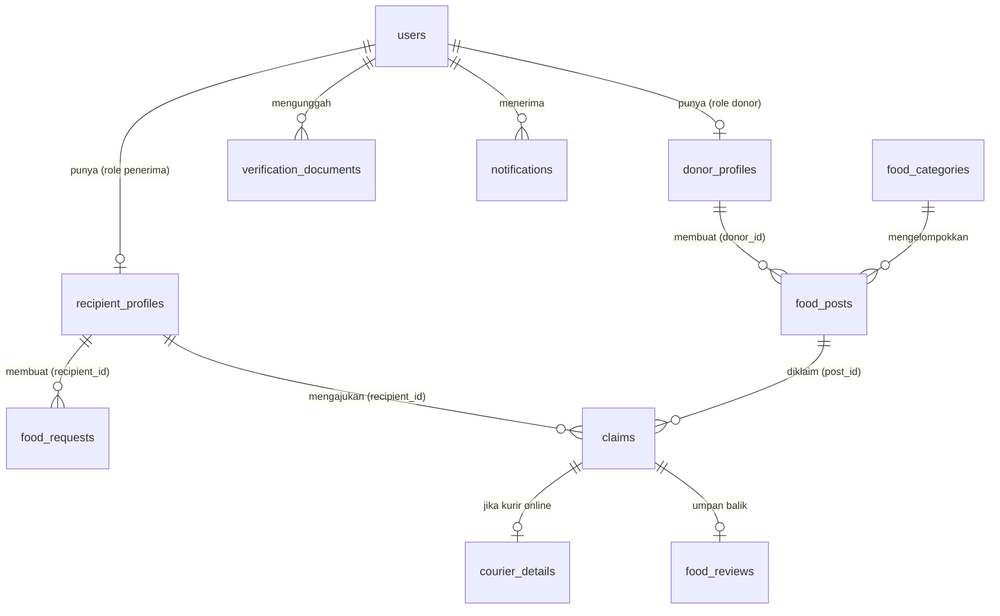

# FoodBridge — Referensi Database

Sumber: ERD final FoodBridge (Visual Paradigm, 11 entitas). Stack: Laravel + MySQL.
Dokumen ini dipakai sebagai landasan untuk generate migration dan model.

Tanda di dokumen ini:
- **Null = Ya** → kolom bertanda `N` di ERD.
- **⚠** → ada hal yang perlu dicek, dijelaskan di bagian [Temuan ERD](#7-temuan-erd-yang-perlu-dicek).
- **(usulan)** → tidak ada di ERD/proposal, hanya saran agar siap dipakai di kode.

---

## 1. Ringkasan Tabel

| # | Tabel | Model | Fungsi | PBI terkait |
|---|---|---|---|---|
| 1 | `users` | `User` | Akun & autentikasi semua peran (donor, penerima, administrator) | PBI-02 |
| 2 | `donor_profiles` | `DonorProfile` | Profil usaha Donor + titik lokasi | PBI-04 |
| 3 | `recipient_profiles` | `RecipientProfile` | Profil lembaga Penerima + titik lokasi | PBI-04 |
| 4 | `verification_documents` | `VerificationDocument` | Dokumen legalitas untuk diverifikasi Admin | PBI-02, 03 |
| 5 | `food_categories` | `FoodCategory` | Kategori gizi makanan | PBI-05 |
| 6 | `food_posts` | `FoodPost` | Postingan makanan berlebih oleh Donor | PBI-05, 06 |
| 7 | `food_requests` | `FoodRequest` | Request Board: kebutuhan mendesak Penerima | PBI-10 |
| 8 | `claims` | `Claim` | Klaim Penerima atas postingan; pusat alur serah terima | PBI-07, 09, 12 |
| 9 | `courier_details` | `CourierDetail` | Data pengemudi (hanya jika kurir online) | PBI-11 |
| 10 | `food_reviews` | `FoodReview` | Ulasan kualitas **dan** laporan makanan tidak layak (dibedakan `jenis_feedback`) | PBI-13, 14 |
| 11 | `notifications` | `InAppNotification` ⚠ | Notifikasi in-app | PBI-08 |

Tidak ada tabel untuk dashboard dampak dan ekspor Excel. Datanya dihitung dari join `claims`, `food_posts`, dan tabel profil (PBI-15–17).

---

## 2. Diagram Relasi

Kardinalitas:

| Relasi | Kardinalitas |
|---|---|
| users ↔ donor_profiles | 1 : 0..1 (admin tidak punya profil) |
| users ↔ recipient_profiles | 1 : 0..1 |
| users → verification_documents | 1 : 0..* |
| users → notifications | 1 : 0..* |
| donor_profiles → food_posts | 1 : 0..* |
| food_categories → food_posts | 1 : 0..* |
| recipient_profiles → food_requests | 1 : 0..* |
| recipient_profiles → claims | 1 : 0..* |
| food_posts → claims | 1 : 0..* |
| claims ↔ courier_details | 1 : 0..1 |
| claims ↔ food_reviews | 1 : 0..1 |

---

## 3. Detail Tabel

Konversi tipe ERD → Laravel: `integer(10)` → integer/`id()`, `varchar(n)` → `string(n)`, `decimal(10,7)` → `decimal(10,7)`, `timestamp` → `timestamp`, `date` → `date`, `binary(1)` → `boolean`.

### 3.1 `users`

| Kolom | Tipe | Null | Key | Keterangan |
|---|---|---|---|---|
| id | integer(10) | Tidak | PK | |
| nama | varchar(255) | Tidak | U ⚠ | Nama pengguna/PIC |
| email | varchar(255) | Tidak | U | Identitas login |
| password | varchar(255) | Tidak | | Hash |
| no_hp | varchar(20) | Tidak | | |
| role | varchar(255) | Tidak | | `donor` / `penerima` / `administrator` |
| status_akun | varchar(255) | Tidak | | Status verifikasi akun |

### 3.2 `donor_profiles`

| Kolom | Tipe | Null | Key | Keterangan |
|---|---|---|---|---|
| id | integer(10) | Tidak | PK | |
| nama_usaha | varchar(255) | Tidak | U | |
| alamat | varchar(255) | Tidak | | |
| jenis_usaha | varchar(255) | Tidak | | Restoran, hotel, katering, dapur MBG, dst. |
| lat | decimal(10,7) | Ya | | |
| lng | decimal(10,7) | Ya | | |
| user_id | integer(10) | Tidak | FK → users.id | 1:1 ⚠ |

### 3.3 `recipient_profiles`

| Kolom | Tipe | Null | Key | Keterangan |
|---|---|---|---|---|
| id | integer(10) | Tidak | PK | |
| nama_lembaga | varchar(255) | Tidak | | |
| jenis_lembaga | varchar(255) | Tidak | | Panti asuhan, dapur umum, dst. |
| alamat | varchar(255) | Tidak | | |
| lat | decimal(10,7) | Ya | | |
| lng | decimal(10,7) | Ya | | |
| user_id | integer(10) | Tidak | FK → users.id | 1:1 ⚠ |

### 3.4 `verification_documents`

| Kolom | Tipe | Null | Key | Keterangan |
|---|---|---|---|---|
| id | integer(10) | Tidak | PK | |
| jenis_dokumen | varchar(255) | Tidak | | |
| file_path | varchar(255) | Tidak | | Path file di storage (disarankan disk private) |
| status | varchar(255) | Tidak | | Status tinjauan Admin |
| catatan | varchar(255) | Ya | | Alasan penolakan/catatan Admin |
| verified_at | timestamp | Tidak ⚠ | | Waktu ditinjau; seharusnya nullable |
| user_id | integer(10) | Tidak | FK → users.id | |

### 3.5 `food_categories`

| Kolom | Tipe | Null | Key | Keterangan |
|---|---|---|---|---|
| id | integer(10) | Tidak | PK | |
| nama_kategori | varchar(255) | Tidak | | Kategori gizi |

### 3.6 `food_posts`

| Kolom | Tipe | Null | Key | Keterangan |
|---|---|---|---|---|
| id | integer(10) | Tidak | PK | |
| judul | varchar(255) | Tidak | | |
| deskripsi | varchar(255) | Tidak | | |
| foto | varchar(255) | Tidak | | Path foto |
| jumlah_porsi | integer(10) | Tidak | | Total porsi yang diposting |
| sisa_porsi | integer(10) | Tidak | | Porsi yang masih bisa diklaim |
| alamat | varchar(255) | Tidak | | Lokasi pengambilan |
| lat | decimal(10,7) | Tidak | | |
| lng | decimal(10,7) | Tidak | | |
| batas_konsumsi | timestamp | Tidak | | Safety hours; lewat batas → kedaluwarsa |
| status | varchar(255) | Tidak | | |
| donor_id | integer(10) | Tidak | FK → **donor_profiles.id** | |
| category_id | integer(10) | Tidak | FK → food_categories.id | |

### 3.7 `food_requests` (Request Board)

| Kolom | Tipe | Null | Key | Keterangan |
|---|---|---|---|---|
| id | integer(10) | Tidak | PK | |
| recipient_id | integer(10) | Tidak | FK → **recipient_profiles.id** | |
| judul | varchar(255) | Tidak | | |
| deskripsi | varchar(255) | Ya | | |
| jumlah_porsi | integer(10) | Tidak | | Porsi yang dibutuhkan |
| batas_waktu | timestamp | Tidak | | |
| status | varchar(255) | Tidak | | |
| created_at | timestamp | Tidak | | Tidak ada `updated_at` |

### 3.8 `claims`

| Kolom | Tipe | Null | Key | Keterangan |
|---|---|---|---|---|
| id | integer(10) | Tidak | PK | |
| jumlah_porsi | integer(10) | Tidak | | Porsi yang diklaim |
| status | varchar(255) | Tidak | | |
| metode_pengambilan | varchar(255) | Ya | | Diisi setelah klaim disetujui: self pickup / kurir online |
| kode_verifikasi | varchar(255) | Ya | | 6 digit, hanya untuk self pickup |
| tanggal_klaim | date | Tidak | | Dasar hitung kuota harian |
| approved_at | timestamp | Tidak ⚠ | | Seharusnya nullable (klaim yang belum/tidak disetujui) |
| completed_at | timestamp | Ya | | Diisi saat Donor menekan "Makanan sudah diserahkan" |
| post_id | integer(10) | Tidak | FK → food_posts.id | |
| recipient_id | integer(10) | Tidak | FK → **recipient_profiles.id** | |

### 3.9 `courier_details`

Hanya dibuat jika klaim memakai kurir online.

| Kolom | Tipe | Null | Key | Keterangan |
|---|---|---|---|---|
| id | integer(10) | Tidak | PK | |
| claim_id | integer(10) | Tidak | FK → claims.id | 1:1 ⚠ |
| platform | varchar(255) | Tidak | | Gojek / Grab |
| nama_pengemudi | varchar(255) | Tidak | | |
| no_kendaraan | varchar(20) | Tidak | | |
| kode_verifikasi_kurir | varchar(255) | Tidak | | Kode dari aplikasi pihak ketiga |
| foto_bukti | varchar(255) | Tidak | | Screenshot pesanan |
| created_at | timestamp | Tidak | | Tidak ada `updated_at` |

### 3.10 `food_reviews`

Satu tabel untuk dua hal: ulasan kualitas dan laporan makanan tidak layak, dibedakan oleh `jenis_feedback`.

| Kolom | Tipe | Null | Key | Keterangan |
|---|---|---|---|---|
| id | integer(10) | Tidak | PK | |
| claim_id | integer(10) | Tidak | FK → claims.id | 1:1 ⚠ |
| rating | integer(10) | Tidak ⚠ | | Untuk laporan mungkin tidak relevan |
| komentar | varchar(255) | Tidak | | |
| created_at | timestamp | Ya ⚠ | | Tidak ada `updated_at` |
| jenis_feedback | varchar(255) | Tidak | | `ulasan` / `laporan` |
| foto_bukti | varchar(255) | Ya | | Foto kondisi makanan |
| status_penanganan | varchar(255) | Ya | | Diisi Admin untuk laporan |
| tindak_lanjut | varchar(255) | Ya | | Catatan tindakan Admin |

### 3.11 `notifications`

| Kolom | Tipe | Null | Key | Keterangan |
|---|---|---|---|---|
| id | integer(10) | Tidak | PK | |
| judul | varchar(255) | Tidak | | |
| pesan | varchar(255) | Tidak | | |
| tipe | varchar(255) | Tidak | | Jenis peristiwa |
| is_read | binary(1) | Tidak | | Boolean, default `false` (usulan) |
| created_at | timestamp | Tidak | | Tidak ada `updated_at` |
| user_id | integer(10) | Tidak | FK → users.id | Penerima notifikasi |

---

## 4. Relasi Eloquent

Foreign key tidak mengikuti konvensi Laravel di beberapa tempat (`donor_id`, `recipient_id`, `post_id`, `category_id`), jadi harus ditulis eksplisit.

| Model | Relasi |
|---|---|
| `User` | `hasOne(DonorProfile)`, `hasOne(RecipientProfile)`, `hasMany(VerificationDocument)`, `hasMany(InAppNotification)` |
| `DonorProfile` | `belongsTo(User)`, `hasMany(FoodPost, 'donor_id')`, `hasManyThrough(Claim, FoodPost, 'donor_id', 'post_id')` |
| `RecipientProfile` | `belongsTo(User)`, `hasMany(FoodRequest, 'recipient_id')`, `hasMany(Claim, 'recipient_id')` |
| `VerificationDocument` | `belongsTo(User)` |
| `FoodCategory` | `hasMany(FoodPost, 'category_id')` |
| `FoodPost` | `belongsTo(DonorProfile, 'donor_id')` (nama relasi `donor`), `belongsTo(FoodCategory, 'category_id')` (`category`), `hasMany(Claim, 'post_id')` |
| `FoodRequest` | `belongsTo(RecipientProfile, 'recipient_id')` (`recipient`) |
| `Claim` | `belongsTo(FoodPost, 'post_id')` (`post`), `belongsTo(RecipientProfile, 'recipient_id')` (`recipient`), `hasOne(CourierDetail)`, `hasOne(FoodReview)` |
| `CourierDetail` | `belongsTo(Claim)` |
| `FoodReview` | `belongsTo(Claim)` |
| `InAppNotification` | `belongsTo(User)` |

Alur akses dari user yang login: `Auth::user()->donorProfile->id` adalah nilai `donor_id`, dan `Auth::user()->recipientProfile->id` adalah nilai `recipient_id`. Keduanya **bukan** `users.id`.

---

## 5. Nilai Status / Enum (usulan)

ERD hanya menyebut tipe `varchar(255)`. Nilai berikut diturunkan dari alur di proposal. Sebaiknya dijadikan PHP backed enum atau konstanta di model, lalu disepakati tim sebelum dipakai.

| Kolom | Nilai |
|---|---|
| `users.role` | `donor`, `penerima`, `administrator` |
| `users.status_akun` | `menunggu`, `aktif`, `ditolak` |
| `verification_documents.status` | `menunggu`, `disetujui`, `ditolak` |
| `food_posts.status` | `tersedia`, `habis`, `kedaluwarsa` |
| `food_requests.status` | `terbuka`, `ditutup` |
| `claims.status` | `menunggu`, `disetujui`, `ditolak`, `selesai` |
| `claims.metode_pengambilan` | `self_pickup`, `kurir_online` |
| `courier_details.platform` | `gojek`, `grab` |
| `food_reviews.jenis_feedback` | `ulasan`, `laporan` |
| `food_reviews.status_penanganan` | `menunggu`, `diproses`, `selesai` (null untuk `ulasan`) |
| `notifications.tipe` | mis. `akun`, `klaim`, `laporan` |

---

## 6. Alur Data Utama

1. **Registrasi:** `users` (role, `status_akun = menunggu`) → profil (`donor_profiles` / `recipient_profiles`) → `verification_documents`. Admin menyetujui → `status_akun = aktif`.
2. **Posting:** Donor membuat `food_posts` (`sisa_porsi = jumlah_porsi`). Setelah `batas_konsumsi` lewat, post berstatus `kedaluwarsa` dan tidak tampil di katalog.
3. **Klaim:** Penerima membuat `claims` (`status = menunggu`). Kuota harian dihitung dari klaim milik `recipient_id` dengan `tanggal_klaim` hari ini. Donor menyetujui atau menolak → `approved_at` terisi, `sisa_porsi` berkurang saat disetujui.
4. **Metode pengambilan** (setelah disetujui):
   - `self_pickup` → sistem mengisi `claims.kode_verifikasi` (6 digit), Penerima menunjukkannya ke Donor.
   - `kurir_online` → Penerima mengisi `courier_details`, `kode_verifikasi` tetap null.
5. **Serah terima:** Donor menekan "Makanan sudah diserahkan" → `completed_at` terisi, `status = selesai`.
6. **Umpan balik:** Penerima mengisi `food_reviews`. Jika `jenis_feedback = laporan`, Admin menanganinya lewat `status_penanganan` dan `tindak_lanjut`.
7. **Notifikasi:** setiap perubahan status klaim (dan peristiwa akun/laporan) membuat baris di `notifications`.
8. **Dashboard & ekspor:** hasil join `claims` + `food_posts` + profil. Tidak disimpan.

---

## 7. Temuan ERD yang Perlu Dicek

Hal-hal berikut sebaiknya diputuskan sebelum generate migration dan model.

**Kolom yang diduga salah nullability**
- `verification_documents.verified_at` dan `claims.approved_at` bertanda NOT NULL, padahal terisi hanya setelah ada tinjauan atau persetujuan. Jadikan nullable.
- `food_reviews.rating` NOT NULL, sedangkan untuk `jenis_feedback = laporan` rating belum tentu ada. Pertimbangkan nullable.
- `food_reviews.created_at` nullable, padahal tabel lain NOT NULL. Kemungkinan tidak disengaja.

**Constraint yang tidak tergambar**
- `users.nama` bertanda unique. Dua orang bisa bernama sama, jadi kemungkinan hanya `email` yang seharusnya unique.
- `user_id` di `donor_profiles` dan `recipient_profiles` (relasi 1:1), serta `claim_id` di `courier_details` dan `food_reviews` (maksimal satu per klaim), perlu `unique` agar 1:1 benar-benar ditegakkan di database.
- `onDelete` tidak ada di ERD. Usulan: `cascade` untuk profil, dokumen, notifikasi, `courier_details`, dan `food_reviews`; `restrict` untuk `food_posts` → `claims` agar riwayat penyaluran tidak hilang.
- Usulan index: `food_posts(status, batas_konsumsi)` untuk katalog, dan `claims(recipient_id, tanggal_klaim)` untuk hitung kuota harian.

**Logika yang tidak ada di database**
- Nilai kuota harian tidak disimpan di tabel mana pun. Taruh di `config/` atau konstanta.
- Kedaluwarsa tidak otomatis. Perlu scheduled command yang mengubah `food_posts.status`, atau scope `available()` yang memfilter `batas_konsumsi > now()`.
- `claims.jumlah_porsi` tidak boleh melebihi `food_posts.sisa_porsi`. Validasi di service, idealnya dalam transaksi.

---

## 8. Catatan Generate Model (Laravel)

**Konvensi umum**
- Tipe ID: ERD menulis `integer(10)`. Pakai `id()` dan `foreignId()` (bigint unsigned) untuk kemudahan, asal PK dan FK konsisten. Jika ingin persis sesuai ERD, pakai `unsignedInteger` di keduanya.
- `users`: ERD tidak memuat `remember_token`, `email_verified_at`, maupun `timestamps`. Migration bawaan Laravel menyertakannya, jadi putuskan mau mengikuti ERD atau menambahkannya (jika ditambah, perbarui ERD).
- Timestamps: tabel yang hanya punya `created_at` (`food_requests`, `courier_details`, `food_reviews`, `notifications`) pakai `const UPDATED_AT = null;`. Tabel tanpa keduanya (`users`, profil, `verification_documents`, `food_posts`, `food_categories`, `claims`) pakai `public $timestamps = false;`.
- Kolom waktu perlu cast `datetime`, yaitu `batas_konsumsi`, `batas_waktu`, `approved_at`, `completed_at`, `verified_at`. `tanggal_klaim` cast `date`.
- `lat`/`lng` bertipe decimal dan dikembalikan Eloquent sebagai string. Cast `float` atau `decimal:7`, dan konversi ke float sebelum dikirim ke Leaflet.
- `users.password` cast `hashed` dan masuk `$hidden`. `notifications.is_read` cast `boolean`.

**Penamaan model notifikasi**
Laravel punya tabel `notifications` bawaan untuk sistem notifikasi database (kolom `type`, `notifiable`, `data`, `read_at`) dan facade `Notification`. Tabel di ERD ini skemanya berbeda. Agar tidak bentrok:
- Beri nama model `InAppNotification` dengan `protected $table = 'notifications';`.
- Jangan jalankan `php artisan notifications:table`.
- Jangan pakai channel `database` dari trait `Notifiable`.

**Privasi (NFR-08)**
- `verification_documents.file_path` dan `courier_details.foto_bukti` simpan di disk private, bukan `public`.
- Data `courier_details` hanya boleh dibaca Donor pemilik post terkait dan Admin. Terapkan lewat Policy.

**Urutan migration (berdasarkan dependensi FK)**

| Urutan | Tabel |
|---|---|
| 1 | `users` |
| 2 | `food_categories` |
| 3 | `donor_profiles`, `recipient_profiles` |
| 4 | `verification_documents` |
| 5 | `food_posts` |
| 6 | `food_requests` |
| 7 | `claims` |
| 8 | `courier_details`, `food_reviews` |
| 9 | `notifications` |

Tabel urutan 1–7 dan 9 dibutuhkan di Sprint 1. `courier_details` dan `food_reviews` baru dipakai di Sprint 2, tetapi migration-nya boleh dibuat sekaligus di awal supaya skema lengkap.