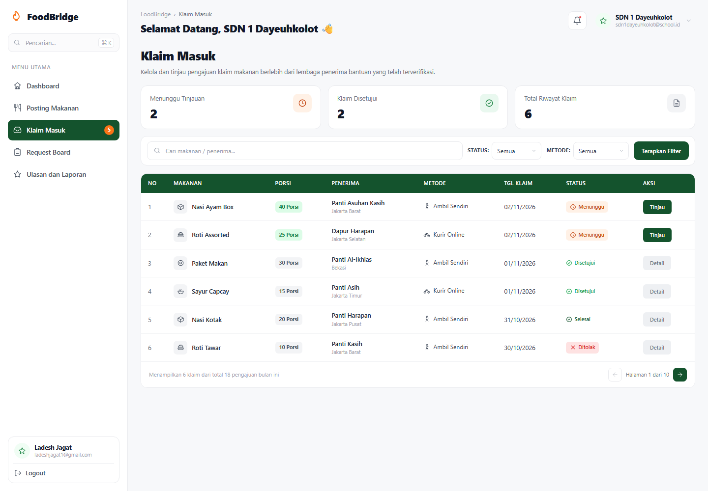

# Mockup — Halaman "Klaim Masuk" (Referensi)

Folder ini berisi **referensi visual dan potongan kode** untuk halaman dashboard **Klaim Masuk**
(tinjau pengajuan klaim makanan dari lembaga penerima). Isinya **bukan bagian dari aplikasi**
dan tidak dipanggil oleh route mana pun di repo ini.

Sumber: project Laravel 12 terpisah yang dibuat khusus sebagai mockup (Blade + CSS murni,
tanpa Tailwind, tanpa build step).

## Isi folder

| Path | Keterangan |
| --- | --- |
| `preview-dashboard.png` | Tangkapan layar hasil render (1440×1000) |
| `css/dashboard.css` | Seluruh styling: sidebar, header, kartu statistik, filter, tabel, pagination |
| `views/layouts/app.blade.php` | Layout HTML (memuat font Inter + `css/dashboard.css`) |
| `views/partials/sidebar.blade.php` | Sidebar: brand, pencarian, menu, kartu profil |
| `views/partials/header.blade.php` | Breadcrumb, sapaan, notifikasi, profil instansi |
| `views/claims/index.blade.php` | Halaman utama: statistik, filter, tabel 6 baris, pagination |
| `views/components/icon.blade.php` | Ikon SVG inline (tanpa dependency eksternal) |
| `views/components/status-badge.blade.php` | Badge status: Menunggu / Disetujui / Selesai / Ditolak |
| `data/Claim.php` | Contoh model + konstanta status & metode |
| `data/ClaimSeeder.php` | 6 baris data contoh sesuai desain |
| `data/ClaimController.php` | Logika filter (`q`, `status`, `method`) dan statistik |
| `data/foodbridge.php` | Contoh config profil pengguna, instansi, dan menu sidebar |

## Spesifikasi desain

- **Layout**: sidebar fixed 260px + area konten, latar off-white `#f7f8fa`.
- **Warna primer**: forest green `#14532d` (tombol utama, header tabel, menu aktif).
- **Warna status**: oranye `#fff1e6`/`#c2410c` (menunggu), hijau `#16a34a` (disetujui),
  hijau tua `#14532d` (selesai), merah `#fee2e2`/`#dc2626` (ditolak).
- **Tipografi**: Inter (fallback Segoe UI/Roboto).
- **Data tabel**: 6 baris — Nasi Ayam Box, Roti Assorted, Paket Makan, Sayur Capcay,
  Nasi Kotak, Roti Tawar.
- **Pagination**: teks "Menampilkan 6 klaim dari total 18 pengajuan bulan ini" dan
  "Halaman 1 dari 10" (nilai statis mengikuti desain).

## Cara memakai sebagai referensi

1. Ambil `css/dashboard.css` → salin ke `public/css/dashboard.css` (atau konversi ke utility Tailwind).
2. Ambil struktur markup di `views/claims/index.blade.php` sebagai acuan tata letak.
3. Logika filter pada `data/ClaimController.php` bisa diadaptasi ke `Recipient\ClaimController`
   atau `Donor\ClaimController` yang sudah ada.
4. Sesuaikan nama field dengan model `App\Models\Claim` di aplikasi ini
   (`jumlah_porsi`, `status`, `metode_pengambilan`, `tanggal_klaim`, dst.).

## Catatan integrasi

- Aplikasi ini memakai **Laravel 13 + Tailwind CSS 4 + Alpine.js**, sedangkan mockup memakai
  CSS murni. Untuk dipakai produksi, markup perlu diubah ke komponen `x-app-layout`,
  `x-button`, dan `x-icon` yang sudah ada di `resources/views/components`.
- Route, migration, dan konfigurasi mockup **tidak** disertakan agar tidak bentrok dengan
  skema database aplikasi.
